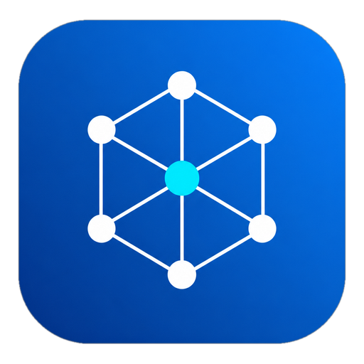
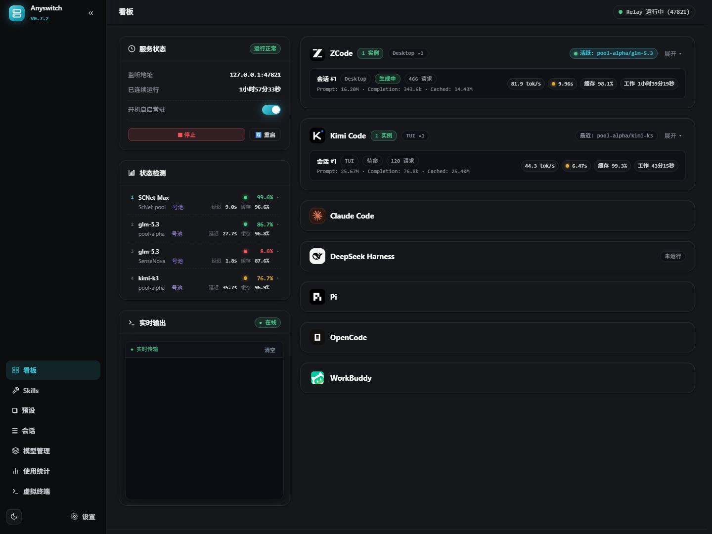
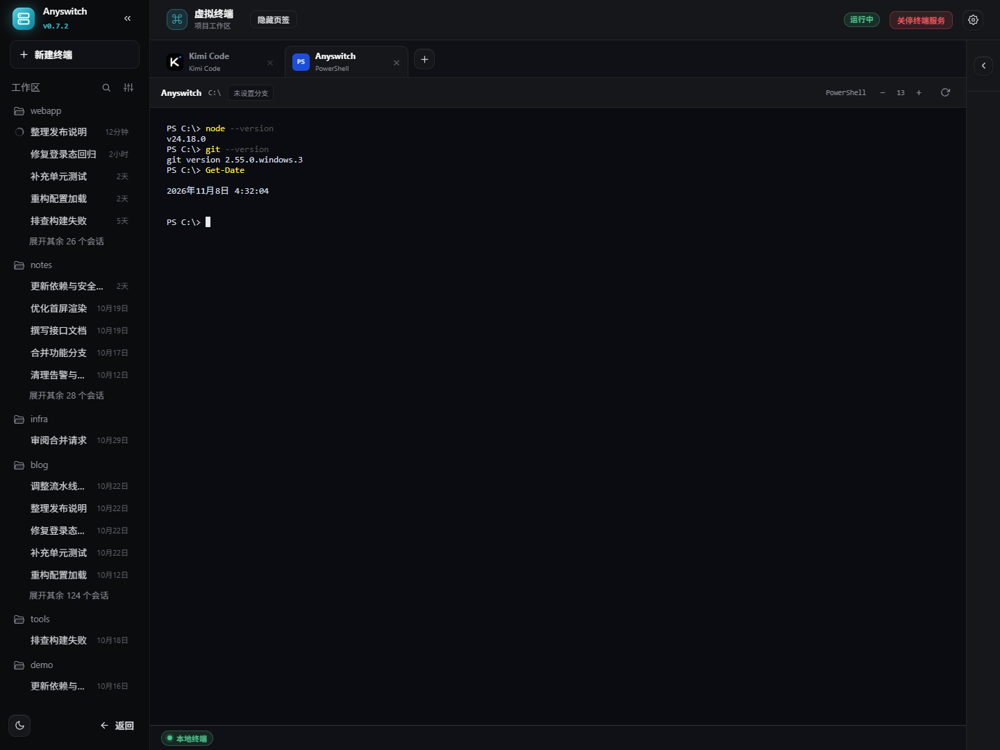
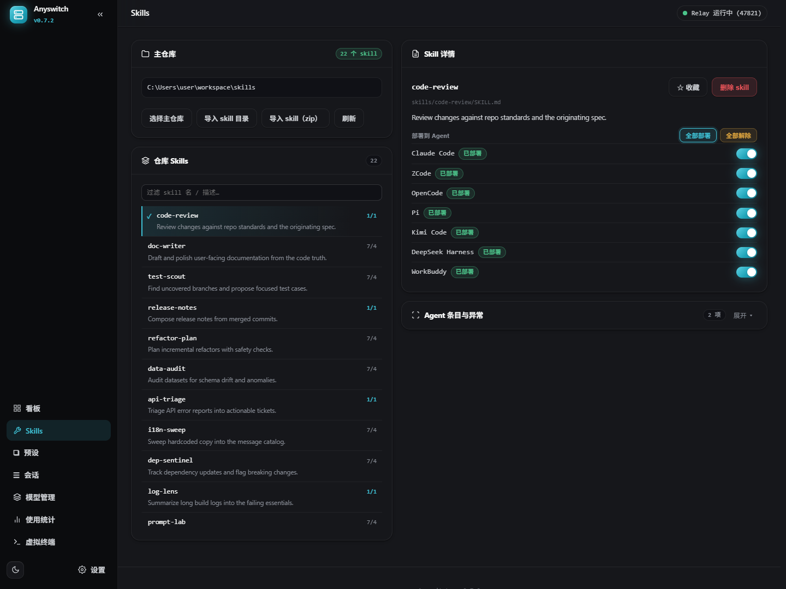

<sub>🌐 <a href="README.md">中文</a> · <b>English</b></sub>

<div align="center">

<p></p>

# Anyswitch

**A local AI request gateway and browser control panel for Windows**

Configure model channels in one place, forward client requests to your chosen providers, and inspect requests, routes, and usage in your browser.

[Download Windows x64 installer](https://github.com/Aurora0134/Anyswitch/releases/download/v0.7.5/anyswitch-v0.7.5-win-x64-setup.exe) · [v0.7.5 source](https://github.com/Aurora0134/Anyswitch/tree/v0.7.5) · [Release notes](https://github.com/Aurora0134/Anyswitch/releases/tag/v0.7.5)

Windows 10/11 x64. The installer is unsigned, so Windows may show an unknown-publisher warning.

</div>

## Send your first request

After setup, open **Anyswitch (Installed)** from the Start menu. The shortcut starts the local panel and opens it in your default browser. The installer includes Node.js.

[Open the local panel](http://127.0.0.1:47820/panel)

1. In **Model management (模型管理)**, select **Add channel (新增渠道)** and enter a channel ID, the upstream Base URL, and an API key. Windows DPAPI encrypts the key for the current user.
2. Save the channel and wait for model discovery. If the provider does not supply a model list, add a model ID manually.
3. If the relay is stopped, select **Start (启动)** under **Dashboard → Service status**.
4. Open **Virtual terminal (虚拟终端)**, select **+**, and start an installed CLI client. You can also use a client launcher listed below from a regular terminal.
5. Select a configured model in the client and send a message. Return to the **Dashboard (看板)** to see the result, or open the request log under **Usage stats (使用统计)** for details.



These screenshots show an earlier version of the panel.

## What you can do

### Connect clients

Anyswitch provides launchers for the clients below. Once a CLI client is connected, you can start it with its usual command in a newly opened terminal. Managed settings direct requests to the local gateway and Anyswitch stores the upstream API key.

| Protocol | Client launchers |
| --- | --- |
| Anthropic Messages | [Claude Code](src/launchers/launcher.mjs), [Kimi Code](src/launchers/kimi-launcher.mjs) |
| OpenAI Responses | [Codex CLI](src/launchers/codex-launcher.mjs) |
| OpenAI compatible | [OpenCode](src/launchers/opencode-launcher.mjs), [Pi](src/launchers/pi-launcher.mjs), [ZCode](src/launchers/zcode-launcher.mjs), [ZCode CLI](src/launchers/zcode-cli-launcher.mjs), [DeepSeek Harness](src/launchers/dsh-launcher.mjs), [Qoder](src/launchers/qoder-launcher.mjs), [Grok Build](src/launchers/grok-launcher.mjs), [WorkBuddy](src/launchers/workbuddy-launcher.mjs) |

On a source install, you can run a launcher directly. For example, run `node src/launchers/codex-launcher.mjs` from the repository directory. For ZCode CLI, supply your own CLI distribution and set `ZCODE_CLI_EXECUTABLE` to its `bin\zcode.mjs` entry point.

### Set up routing and failover

Add fallback URLs when a channel has multiple endpoints. To switch between channels, group them into a pool or configure a route chain for a client’s `auto` model or a custom virtual model. The dashboard shows the active route and the status of each node.

### Check usage and sessions

Usage stats show request counts, tokens, success rate, time to first token, and historical trends. Open Sessions to browse conversations saved by local clients.

### Run a CLI in the panel

The virtual terminal can open PowerShell or start a detected CLI client. Its side panel shows requests and response speed for that client instance. Source installs require the terminal dependencies. [Run from source](#run-from-source)



### Share prompt presets and skills

Enable prompt presets to sync recurring instructions to supported clients. Use the Skills page to manage skills in one local directory and deploy them to installed clients.



## Run from source

Install Git and a supported version of Node.js on Windows (`>=22.15.0 <23 || >=23.8.0`), then run these commands in Command Prompt. Run `npm install` if you want the virtual terminal.

```bat
git clone --branch v0.7.5 --single-branch https://github.com/Aurora0134/Anyswitch.git
cd Anyswitch
npm install
wscript panel-app.vbs
```

## Upgrade to v0.7.5

Before upgrading, you can back up `%LOCALAPPDATA%\Anyswitch\`. The app and user data are stored separately, so upgrades under the same Windows user retain channels, credentials, settings, presets, and usage history. Upgrade between sessions. Restarting the relay interrupts in-flight requests and running virtual terminals.

### Upgrade an older source install

GitHub’s v0.7.4 release has no installer. You can switch to the v0.7.5 Windows x64 installer and keep your old source directory and user data. To stay with source, run `git status --short` in the existing repository and handle local changes. Once the working tree is clean, run the commands below, then restart the services from the dashboard.

```bat
git fetch --no-tags origin tag v0.7.5
git switch --detach v0.7.5
npm install
```

### Upgrade a packaged install

1. If you are running **0.7.5-preview**, wait for requests and terminal sessions to finish, then select **Stop (停止)** under **Service status (服务状态)** on the dashboard and choose **Confirm stop (确认停止)**.
2. Download the v0.7.5 installer at the top of this page and run it in the existing installation location. The installer preserves your user data.
3. Sign out of Windows and back in to exit the old panel process. Open **Anyswitch (Installed)** from the Start menu, then select **Stable (稳定版)** in **Settings → Advanced options → Update channel**.

Starting with v0.7.5, packaged installs can check for, download, and apply future updates from **Settings → About**. The panel verifies the signature of the standalone update package.

## Project docs

- [Architecture and runtime behavior](docs/architecture.md) · [Security model and vulnerability reporting](SECURITY.md)
- [Usage stats specification](docs/stats-spec.md) · [Runtime log specification](docs/runtime-log-spec.md)
- [Contributing](CONTRIBUTING.md) · [Report an issue](https://github.com/Aurora0134/Anyswitch/issues)
- [Apache-2.0](LICENSE) · [Third-party notices](NOTICE)
