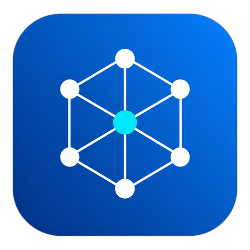
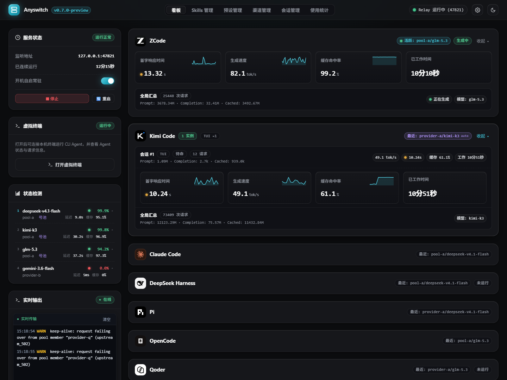
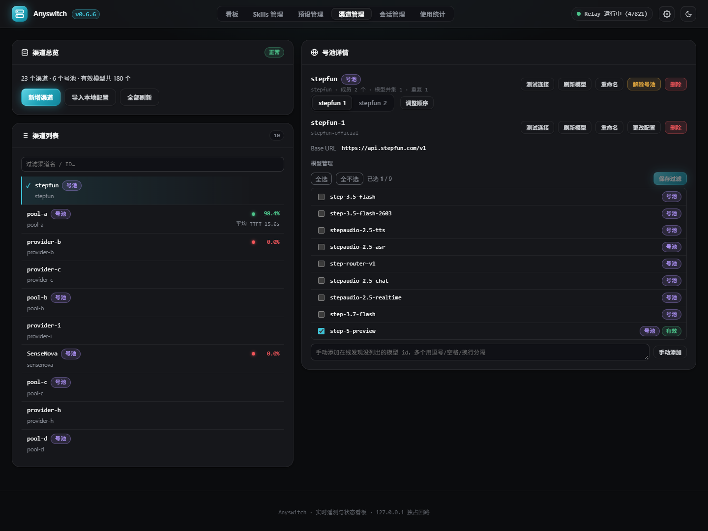
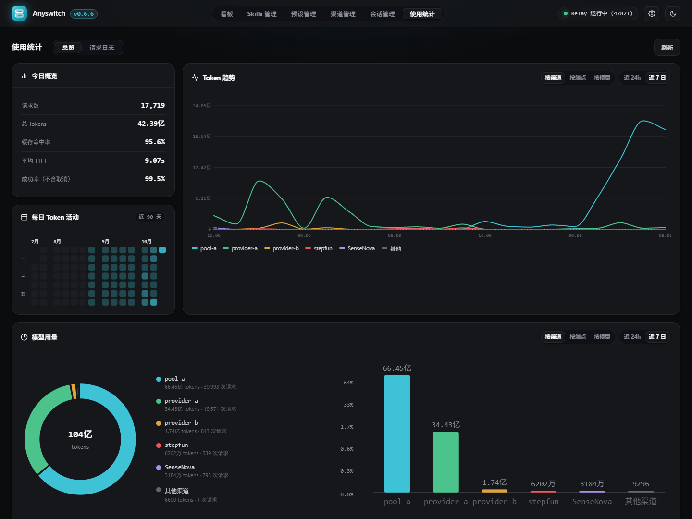
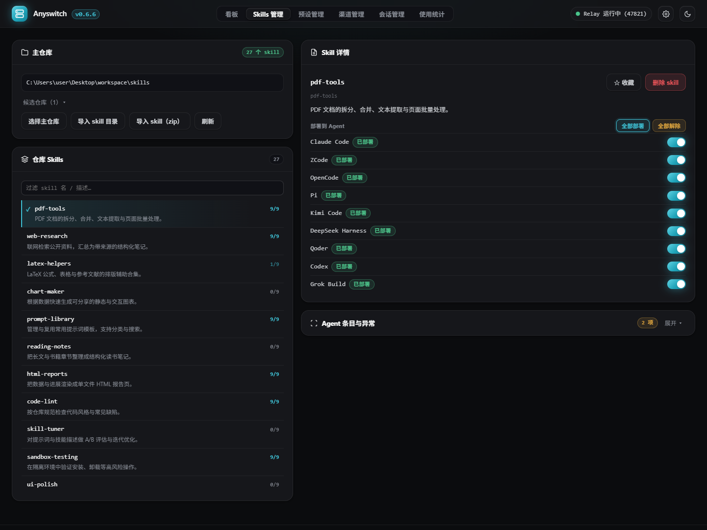
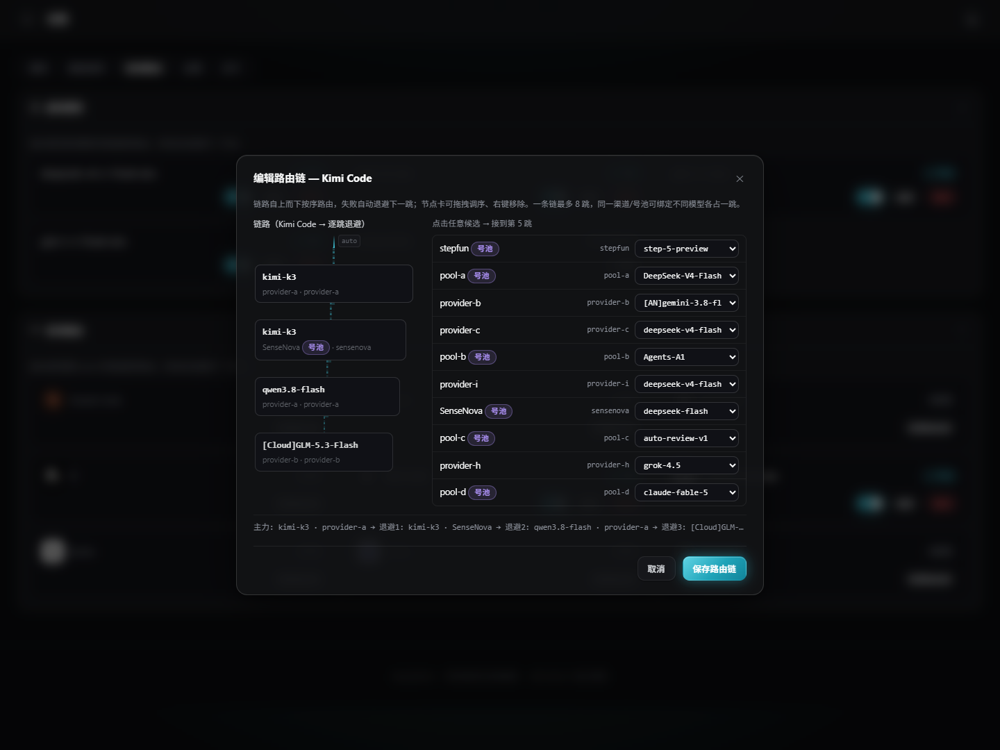
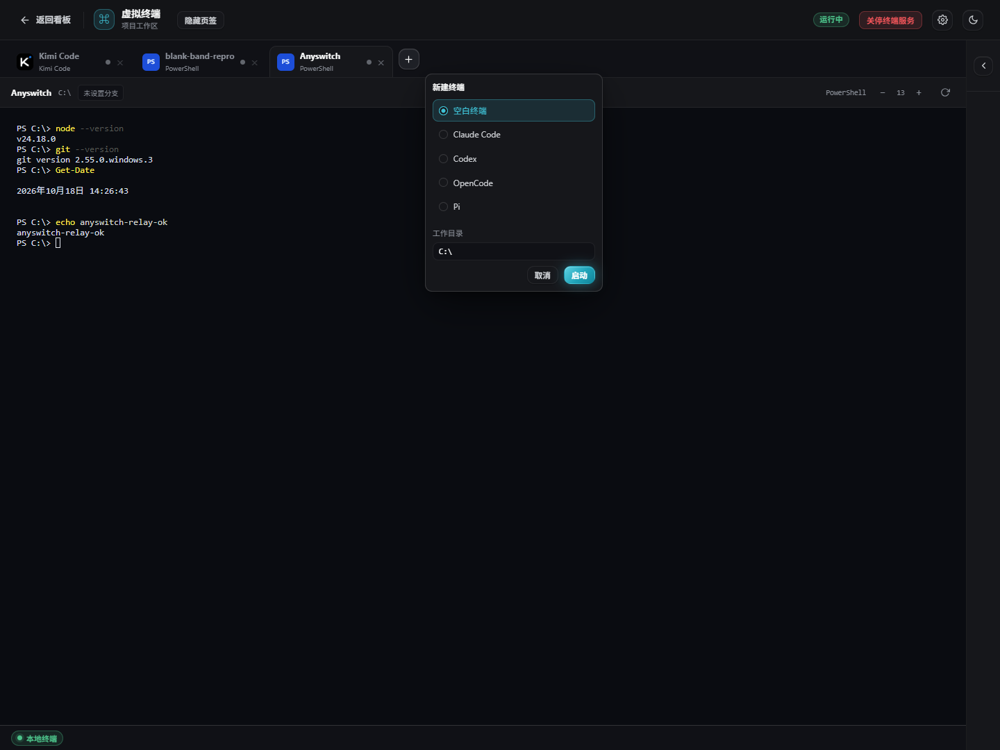
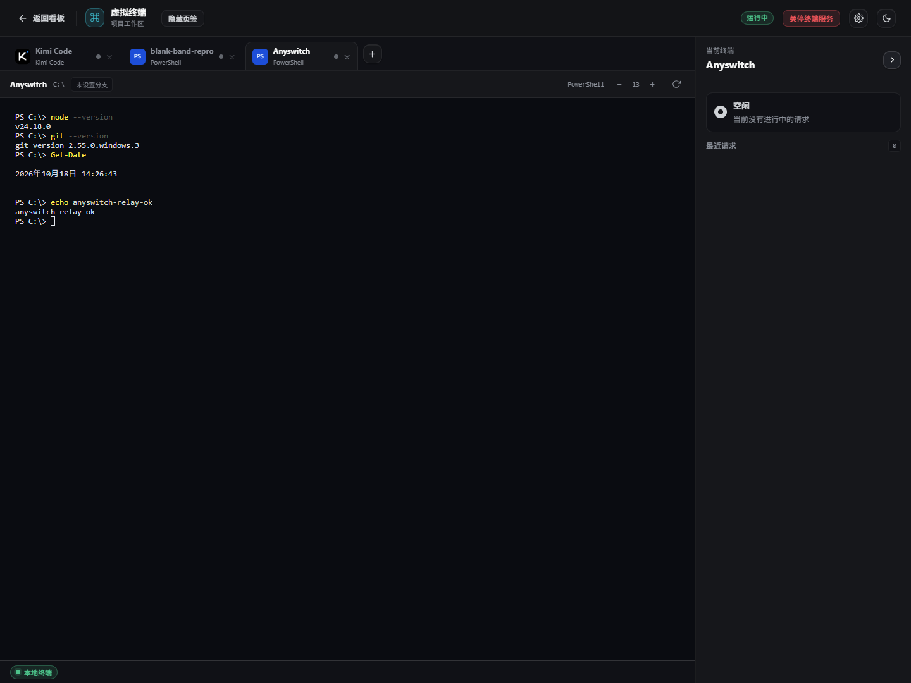
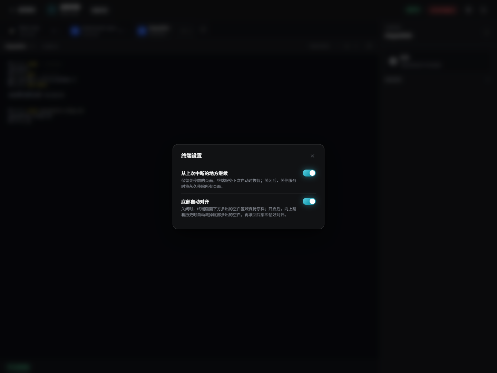

<sub>🌐 <a href="README.md">中文</a> · <b>English</b></sub>

<div align="center">

<p></p>

# Anyswitch

> *"Configure once. Nine agents share it."*

[](LICENSE)
[](https://github.com/Aurora0134/Anyswitch/tree/v0.7.0-preview)
[](#boundaries-and-limitations-to-accept-first)
[](package.json)

<br>

**A relay and control panel on your machine: configure channels once, connect nine coding agents, keep one sealed copy of every upstream key.**

<br>

Setting up a provider for your first agent is easy: base URL, key, pick models — five minutes. By the fourth agent you are copying the same dozens of entries into a fourth config file. By the ninth, nine plaintext keys sit in nine directories that nine agent processes can read.

Running them is noisier: when a channel dies you switch it by hand, long sessions break mid-sentence, and finding out who just sent that 250 tok/s request means matching timestamps across nine windows and a pile of logs.

This tool exists to make three things true at once: configure once, keep exactly one sealed copy of the key, and see who is running and which route carried the request.

```bat
git clone --branch v0.7.0-preview --single-branch https://github.com/Aurora0134/Anyswitch.git "%LOCALAPPDATA%\Anyswitch\app"
```

Runs locally on Windows · source-distributed, no installer · the panel and relay listen on loopback only

[See it](#what-it-looks-like-a-showcase-of-configuration-routing-and-readings-in-one-window) · [Install](#install-and-run) · [Nine agents](#nine-agents-one-way-in) · [Failover](#a-dead-channel-should-not-stop-the-pipeline) · [Readings](#who-is-running-which-route-it-took-how-much-it-used-one-panel-answers) · [Boundaries](#boundaries-and-limitations-to-accept-first)

</div>

---

## What it looks like: a showcase of configuration, routing and readings in one window

The panel lives at `http://127.0.0.1:47820/panel`, the relay at `127.0.0.1:47821`. The panel manages configuration and readings; the relay carries requests. They are separate processes: if the relay stops, the panel still opens and shows you the state.

<p align="center">
  
  
  
  
</p>

A request's path:

```text
Claude Code / Codex / other agents
              │
              ▼
      127.0.0.1:47821 relay
        auth · routing · protocol translation
              │
              ▼
       the OpenAI-compatible upstream you configured
```

What the panel shows directly: Dashboard (relay status, live route chains, recent requests, agent instances), Channels (providers, model discovery, pools, route chains), Virtual models, Usage stats (today at a glance, a 90-day heatmap, TTFT, TPS, request log), Sessions, the Skills master repository with per-agent deployment, prompt presets, Virtual terminal (the optional run surface), plus Settings and client updates.

Screenshots live in [`docs/screenshots/`](docs/screenshots/) — clone the repo and open them directly to verify the pages.

<sub>Screenshots come from the panel running this same code; channel names, usage figures, and the skills list are masked demo data.</sub>

---

## Install and run

### Three things to prepare

- Windows. Credentials are sealed with Windows DPAPI, autostart uses Task Scheduler, and client detection plus parts of the update path also depend on Windows.
- Node.js. `package.json` requires `>=22.15.0 <23 || >=23.8.0`; 24 LTS is recommended. That is an API floor, not a claim that every version in range has been exercised.
- A fresh install directory. Do not unpack new source over a running installation.

### First install

```bat
git clone --branch v0.7.0-preview --single-branch https://github.com/Aurora0134/Anyswitch.git "%LOCALAPPDATA%\Anyswitch\app"
cd /d "%LOCALAPPDATA%\Anyswitch\app"
npm install
wscript panel-app.vbs
```

`npm install` only prepares the virtual terminal's dependencies: the terminal process binding and renderer, 5 direct dependencies in total. Without it, the relay, panel, channel management, launchers and statistics all work; only the terminal page stays closed.

You can also start the panel by hand: `node panel-launcher.mjs`. `panel-app.vbs` finds the launcher relative to its own location, so the install directory does not have to be fixed — point a desktop shortcut straight at it.

### Four steps to your first request

1. Open `http://127.0.0.1:47820/panel` and go to channel management.
2. Add a provider: provider ID, upstream base URL, API key. On save the key is sealed with the current Windows user's DPAPI.
3. Wait for model discovery; if the upstream has no `GET /v1/models`, add model IDs manually. Add fallback URLs if you want failover.
4. Launch your client through its launcher — or straight from the virtual terminal. The launcher hands over the relay address and credentials; every other argument passes through untouched.

Self-check after installing:

```bat
node --version
node --check panel-host.mjs
npm test
```

`npm test` is the repository's full test suite; it needs an `npm install` first, because the virtual terminal tests touch the terminal host.

---

## Nine agents, one way in

Nine agents, nine wirings — configure once and they all live here:

| agent | Protocol surface | Launch |
| --- | --- | --- |
| Claude Code | Anthropic Messages | `node launcher.mjs [claude args]` |
| Kimi Code | Anthropic Messages | `node kimi-launcher.mjs [kimi args]` |
| Codex CLI | OpenAI Responses | `node codex-launcher.mjs [codex args]` |
| OpenCode | OpenAI | `node opencode-launcher.mjs [opencode args]` |
| Pi | OpenAI | `node pi-launcher.mjs [pi args]` |
| ZCode | OpenAI | `node zcode-launcher.mjs [zcode args]` |
| ZCode CLI | OpenAI | `node zcode-cli-launcher.mjs [zcode args]` |
| DeepSeek Harness | OpenAI | `node dsh-launcher.mjs [dsh args]` |
| Qoder | OpenAI | `node qoder-launcher.mjs [qoder args]` |
| Grok Build | OpenAI | `node grok-launcher.mjs [grok args]` |

The ZCode CLI row is explicit-config only: bring your own zcode CLI distribution and point the `ZCODE_CLI_EXECUTABLE` environment variable at its entry file (`bin\zcode.mjs`); without it the launcher is unavailable.

Config sync writes managed channels into each agent's own config location and leaves everything you wrote by hand untouched:

| agent | Where Anyswitch writes |
| --- | --- |
| Kimi Code | `~/.kimi-code/config.toml` |
| Codex | `~/.codex/config.toml` plus a generated model catalog |
| OpenCode | `~/.config/opencode/opencode.json` (your `opencode.jsonc` is never touched) |
| Pi | `~/.pi/agent/models.json` |
| ZCode | `~/.zcode/v2/config.json` |
| DeepSeek Harness | `~/.dsh/profiles/<name>/cordis.patch.yml` |
| Qoder | `~/.qoder/settings.json` |
| Grok Build | `~/.grok/config.toml` |

These files receive a loopback relay address and a local token — your real upstream keys never enter any agent's config directory. Claude Code has no config-file surface; it is wired through its launcher, with optional tier mapping in Settings.

You do not have to re-copy channels that already live in those configs either: BYOK import scans the local configs of 8 endpoints (Claude has no local config surface), pulls OpenAI-compatible channels into the central store, and honestly reports what it skipped.

---

## A dead channel should not stop the pipeline

Three things steer your traffic: pools, route chains and fallback URLs. Each covers one layer, and they stack.

### Pools: one channel down, try the next

Group 2–5 channels into a pool. Requests stick to a member — one conversation does not hop channels mid-way — and a failing member fails over in order. Agents see one pool entry, not a pile of loose channels.

### Route chains: a model name is not married to one channel

Each agent's `auto` model tries its chain hop by hop. A chain node can be a channel or a pool — two layers of failover, stacked.

```text
model name
  └─ node A: primary channel
       └─ node B: pool (2–5 channels, sticky, per-member failover)
            └─ node C: fallback channel (baseURL fallbackURLs)
```

A node that fails twice in a row is demoted; five minutes later real requests drive it back to the head of the chain. Deleting a channel or dissolving a pool prunes every chain reference in the same write — no dangling nodes. Every hop shows a live lamp on the dashboard: which hop is carrying traffic, which one is degraded.

<p align="center">
  
</p>

### Virtual models: one name, all nine agents

A virtual model is your own name bound to a chain of 1–8 nodes. While enabled, it appears next to `auto` in all nine agents' model lists; disable it and it disappears from every catalog.

It answers "the same role should have the same name everywhere": define `deepseek-pro` as "primary channel → backup pool", then pick it in Claude Code or in Codex — the same chain carries the request. Chain state is shared across agents: if one agent latches a node as degraded, another agent's requests skip it directly instead of paying the same tuition.

### Fallback URLs: your provider has more than one entrance

The last safety net sits on the channel itself: a `baseURL` plus several `fallbackURLs`. Each address gets a 180-second generation budget and retries back off exponentially (1s up to a 4s cap); 4xx is terminal and stays put, 5xx moves to the next address. When every address is exhausted, the last real upstream 5xx passes through; pure transport failures return 502.

---

## Who is running, which route it took, how much it used: one panel answers

Configuration and routing are the foundation; the readings are what you use every day. Three places:

- **Dashboard**: relay and terminal-service status, a live lamp on every hop of every route chain, recent requests (including failures and 429s), and one row per agent instance. Several sessions of the same client show up as several rows — they are not merged into one.
- **Usage stats**: today at a glance (requests, tokens, cache hits, average time to first token, success rate), a 90-day heatmap, token trends, per-model usage and a request log.
- **Sessions**: scanned on demand from the nine clients' own session stores, with no separate index. Turn counting lives in the data layer: it counts what you actually said, not tool output dressed up as user input.

Instance attribution is not a guess: a client started through its launcher (or from the virtual terminal) is attributed to that agent's instance by its owning process; desktop GUI forms are recognized separately and not counted as another CLI. There is a cold-cache window — right after the relay starts, before process scanning has warmed up, a launcher-shaped instance row may briefly appear twice; it is reaped after 10 idle minutes.

---

## What's new in 0.7.0

This is a preview on the 0.7 line and collects everything after `v0.6.6`. Against the previous release:

- **An optional new interface**: left-rail navigation, a light page header, flat settings and stats pages, and a rail that folds down to an icon strip. Classic layout is still the default; switch under Settings → General → Display. The screenshots use the default layout.
- **Self-update is one step**: on the About page, confirming "update now" once downloads and applies together; "automatically check for and download updates" now defaults to off; Advanced options gains an "update channel" card, where turning on "bleeding edge" makes update checks follow the latest upstream commits.
- **Endpoint detection fixes**: DeepSeek Harness 0.2's engine subprocess, Claude desktop's build-hash engine directory and opencode's internal service process no longer get cards of their own; qoder's and codex's terminal rails now show metrics and recent requests; codex's resident background daemon no longer counts as a running endpoint.
- **Reordering pool members now takes effect immediately**: after you move a member, the next request follows the new pool order and sticks there again.
- **Skills and presets deploy only to installed agents**: agents you have not installed no longer appear on the dashboard, the auto-routing tiles or the session filter; an empty directory can be confirmed as the master repository.
- **The virtual terminal keeps getting polished (preview)**: the tab bar folds away in one click to give the terminal screen more room, and folding changes the container and the canvas in the same frame; a new "bottom auto-alignment" setting, off by default; many open sessions no longer stutter; colours and alternate-screen content survive a rebuild; closing a session ends its whole process tree; the recent-requests row is now four columns with the dashboard's green/amber/red TTFT colours; and ghost cards plus traffic attribution are fixed for dsh, qoder, codex, opencode and Claude desktop.

The virtual terminal is the largest single piece of work in this release, but it is an optional run surface, not the only way in — without the terminal's dependencies installed, configuration, routing and readings all work as before. Its details are in the next section.

---

## The virtual terminal: run agents inside the panel, readings beside them

The virtual terminal is a full page inside the panel, not a popup: it takes the whole view and the header can return to the dashboard. It is a preview feature and needs one `npm install`; without it, only this page fails to open.

### The "+" menu only lists agents you have installed

The new-session menu lists two things: a blank terminal, and agents that are installed on this machine and detected in CLI form. All nine endpoints — Claude Code, Codex, Kimi Code, OpenCode, Pi, DeepSeek Harness, Grok Build, Qoder, ZCode — appear in their CLI form; desktop GUI forms stay out, and nothing you have not installed appears in the menu.

Pick an agent and start it; the server assembles that session's environment variables: relay address, auth, session identity. Upstream keys do not enter the terminal, are not written to disk, and are never echoed. A blank terminal is always PowerShell, defaults to your user directory, and remembers the last directory you entered.

> One exception, stated plainly: ZCode CLI does not take credentials from environment variables; the relay token is delivered as the key in Anyswitch's own slot config, and only in its own config file.



### The panel knows who a session belongs to — by process, not by reading terminal text

Every terminal session has a real shell process ID on the host side. Attribution works like this: if that shell PID appears in some agent process's ancestor chain, the session is attributed to that agent's instance. The source comment says it plainly: **nothing here parses terminal output text**.

So the right rail shows the same data as that instance's row — in-flight requests, time to first token (<5s green / 5–15s amber / >15s red), generation speed, cache hit rate, active time, and the last 10 requests. After the agent exits the terminal stays; the monitor area goes away with it. Start another agent in the same terminal and it is attributed to the new instance.

Codex is the exception: its desktop sessions share one engine process, so PID-shaped instance rows do not line up. It bridges from codex's session records by "working directory + last active", and binds only when the instance row really exists.

### Refresh keeps the scene: history is rebuilt from the rendered mirror

The old approach replayed the raw byte stream into the terminal, which made long sessions messier, not cleaner. Replay now uses the host-side rendered mirror: clear the screen, then repaint line by line at absolute positions, pushing scrolled-away history into scrollback; a full-screen TUI that is currently on the alternate screen gets switched there before the frame is painted.

After a refresh you are still on the terminal page and on the same tab; each state has its own local record. Reconnects also clear before replaying, so old and new content never stack in duplicate. Replay on the host is budgeted — the mirror holds at most 5,000 lines / 1MB, and a single replay at most 2MB — so "all history is here" is not true; it is "what the mirror still holds is here".



### The details you touch every day

- **Chinese input method**: while composing, the input anchor is pinned to where composition started, so a busy stream cannot drag it around.
- **Copy and paste**: a bare `Ctrl+V` goes through the browser's native paste; a bare `Ctrl+C` copies when there is a selection and still sends an interrupt when there is not, matching terminal habits.
- **Newlines**: `Ctrl+Enter` / `Shift+Enter` insert a newline. Ordinary endpoints receive LF; Codex gets `ESC CR` — it treats LF as submit, so the newline has to hit its own key binding.
- **Font size**: 10–24, default 13; `− / +`, `Ctrl+±` and `Ctrl+wheel` all work, only on the terminal page.
- **Tab bar**: the whole row can be hidden or shown. It is an instant switch, no animation; this release fixes the frame where the container and the canvas re-layout together, so no blank strip flashes.
- **Bottom auto-alignment**: off by default. When on, scrolling up through history trims the blank band left by window resizing, and scrolling back to the bottom lands exactly at the end.
- **Theme**: terminal background, foreground, cursor and selection follow the panel's three skins and light/dark switch; switching re-paints open streams immediately.

### Tabs, service and settings

Tabs can be created, closed and switched; labels are assigned by the server from the agent's display name and cannot be renamed. Closing a working tab asks first, then ends that whole process tree — node-pty only closes the pseudo-console, so decoupled child processes would not exit on their own; this uses a tree kill.

The terminal backend is a separate process (port 47823) owned by the relay: if it crashes the relay restarts it after 1 second, at most 5 times in 10 minutes, and past that it stays "abnormal" until you start it by hand. The page header has two switches:

- **Continue from where you left off** (on by default): the next time the terminal service starts it restores pages and history, but processes do not come back to life — restored sessions are honestly marked as exited.
- **Bottom auto-alignment** (off by default): see above.



---

## How it works: not a forwarder — your local source of truth

```text
%LOCALAPPDATA%\Anyswitch\
├── store.json       provider, model, pool, route-chain and virtual-model metadata
├── credentials\     one DPAPI-sealed file per provider
├── settings.json    panel and per-agent switches
├── terminal-sessions.json  terminal session metadata and history snapshots
├── usage\           daily request and session usage (kept for 90 days)
└── app\             this repository: relay, panel, launchers
```

- **No secrets in `store.json`.** The schema carries a word list (apikey, token, secret, password…) and matches field names segment by segment, refusing the write on a hit; keys connect to the credentials directory only through `credentialFile` references. Verify: `grep -n "SECRET_WORDS" store-schema.mjs`.
- **Keys are decrypted only at request time.** DPAPI runs at current-user scope, one sealed file per channel. The decrypted plaintext is by default reused briefly inside the process, keyed by the ciphertext hash (switchable in Settings; with it off, plaintext is used once and every request decrypts again); rotating the ciphertext invalidates it immediately.
- **Four processes, four ports, all loopback-only.** Panel `127.0.0.1:47820`, relay `127.0.0.1:47821`, watchdog marker `47822`, terminal host `127.0.0.1:47823`.
- **The terminal host is a separate process.** The page is just a browser client: refreshing or reopening the panel does not lose the PTYs, and history is replayed from the host's rendered mirror; the host is owned and supervised by the relay.
- **Zero third-party runtime dependencies in the business code.** All 5 direct dependencies belong to the virtual terminal; exactly one `.mjs` file imports a third-party package: `terminal-host.mjs:14`, node-pty. Verify:

  ```bat
  node -e "console.log(Object.keys(require('./package.json').dependencies).join(' '))"
  node -e "const fs=require('fs');for(const f of fs.readdirSync('.').filter(x=>x.endsWith('.mjs')))for(const l of fs.readFileSync(f,'utf8').split(/\r?\n/))if(/^import .+ from \"/.test(l)&&!/from \"(node:|\.)/.test(l))console.log(f+': '+l.trim())"
  ```

  The second command should print only `terminal-host.mjs: import * as pty from "node-pty";`.

- **Writes are concurrency-guarded.** Panel writes go through content-hash CAS with a file lock; routing catalogs carry a generation digest, and a configuration that changes mid-request refuses to serve the stale one.
- **Panel write routes trust only the local panel.** `POST /panel/api/*` passes an Origin/Referer check; the relay authenticates with a local token from the data root, and so does the terminal host.

Scale is not the pitch, but it is checkable: the repository root holds 239 `.mjs` files (108 implementation, 131 test), about 46,195 lines of implementation code; the panel front-end trio `panel.js` / `panel.html` / `panel.css` is about 23,900 lines.

---

## How it differs from config switchers and plain terminals

| | **Anyswitch** | CC Switch | System terminal + hand-written env |
| --- | --- | --- | --- |
| Acts on | Request traffic: forwarding, protocol translation, backoff, routing | Config files: writes providers into each CLI | Environments and configs you maintain yourself |
| Where upstream keys live | DPAPI-sealed on this machine; agent configs hold only a local token | Inside the agent configs it writes (key included) | Wherever you wrote them — often plaintext in configs or launch scripts |
| Run surface | Built-in virtual terminal, can start agents | None | It runs, but readings and attribution live elsewhere |
| Observability | Terminal rail + dashboard + stats page, all from the same instance data | None | One set per client, none aligned |
| Failover | Pools, route chains, fallback URLs, virtual models | Manual provider switching | Manual config edits |

Two fair points: CC Switch is mature and broad, and its provider preset library with two-way sync is genuinely strong; a system terminal will always be the fastest, least picky option. What Anyswitch adds is putting configuration, runtime and observability on the same local control plane — the price is that you run a local relay and panel yourself.

Comparison based on a read-only review of CC Switch's public repository and docs, checked 2026-10-18.

---

## Security and data flow: sealed on disk, plaintext only in memory

- **Upstream keys land on disk sealed.** One DPAPI-sealed file per channel; decrypting it needs the current Windows user context, so another account cannot read it away.
- **No upstream keys in agent config directories.** What gets written is `http://127.0.0.1:47821/...` and a local token; real keys never pass through any agent process.
- **Panel and relay listen on loopback only.** No `0.0.0.0` binding; panel write routes additionally check Origin/Referer so any page in your browser cannot rewrite your configuration for you.
- **Credentials injected into the terminal travel only through environment variables** (the ZCode CLI slot-config exception is above): not in launch arguments, not on disk, not echoed; the terminal host validates env key names and size when creating a session.
- **Upstream requests do leave this machine.** They go to the provider addresses you configured. Anyswitch guards credential storage, routing configuration and the local control plane; it does not pretend upstream calls are offline.

Report security issues through the GitHub Security Advisories route in [`SECURITY.md`](SECURITY.md); do not publish exploitable details.

---

## Boundaries and limitations to accept first

- ❌ **Windows only; no macOS or Linux support.** DPAPI, Task Scheduler, native client detection and parts of the update path all depend on Windows.
- **No installer.** 0.7.0 ships as source; first installs and machine moves are git clone + `npm install`. Once installed, the panel's About page can self-update.
- **This is a preview on the 0.7 line.** Installations running a stable identity are not offered `v0.7.0-preview`; the stable line is still `v0.6.6`, and installations running a preview identity keep receiving upgrade prompts.
- **The virtual terminal is still preview.** It needs its own `npm install` once; this release's default-off "bottom auto-alignment" and restore policy are still being polished on the preview line.
- **Restarting the relay interrupts in-flight requests and ends every terminal process alive at that moment.** The panel's **Restart** swaps the relay first and then the panel host; run it between sessions. Restarting only the panel host does not kill terminals — the terminal host is owned by the relay.
- **Refresh recovery has a scope.** It restores "still on the terminal page + which tab + whatever history the mirror can still replay"; it does not restore scroll position, does not replay everything since the session began, and does not resurrect sessions whose processes have exited.
- **Terminal tabs cannot be renamed, and a blank terminal's shell is always PowerShell.** Graphical desktop forms (Claude Desktop, Codex desktop and the like) are not terminal candidates.
- **The new interface is an optional switch, not the default.** Classic layout is still the default; the screenshots use the default layout.
- **One-step self-update and the "bleeding edge" channel have not been through a real update yet.** An update replaces the running panel; that step can only be walked by the first person who clicks it.
- **Several endpoint-attribution fixes live in the resident relay and need a relay restart to take effect**; the restart takes open terminal sessions with it, and pages keep only their history, honestly marked as exited.
- **Instance attribution has a cold-cache window.** Right after the relay starts, before process scanning has warmed up, launcher-shaped instance rows may briefly appear twice; they are reaped after 10 idle minutes.
- **Panel-launched sessions for the nine CLIs, virtual models showing up in all nine clients' pickers, and the real install buttons on the About page** are verified down to code and test level, but have not been clicked through on every client for you.
- **No official models, no built-in channels.** Every upstream comes from a provider you fill in yourself; ports 47820 / 47821 / 47822 / 47823 are constants in the code and cannot be changed from the panel.

This is a preview, not a 1.0 product: every line above is real. None of it stops someone whose channels are scattered across nine config files from using it — all of it decides whether it belongs on a production pipeline.

---

## Where the code is, where the data is

```text
Anyswitch/
├── panel-host.mjs              # panel host on 47820
├── relay-host.mjs              # resident relay host on 47821 (supervises the terminal host)
├── panel.mjs                   # panel API and static routes
├── panel-ui/                   # panel pages, styles and scripts
├── launch.mjs                  # relay assembly and request forwarding
├── launcher.mjs                # Claude Code launcher
├── *-launcher.mjs              # launchers for the other agents (ZCode has both desktop and CLI)
├── agent-sync.mjs              # syncs managed channels into agent configs
├── byok-import.mjs             # imports channels from agents' local configs
├── agent-metrics.mjs           # processes, requests, instances and dashboard readings
├── terminal-host.mjs           # terminal host on 47823: PTYs and session state
├── terminal-screen.mjs         # rendered mirror and replay
├── terminal-attribution.mjs    # binds terminal sessions to instances
├── agent-session-env.mjs       # per-session launch and environment assembly
├── session-scan.mjs            # session readers and adapters per agent
├── agent-skills.mjs            # skills master repository and deployment
├── skills/anyswitch-preset/    # optional preset-management skill
├── docs/                       # architecture docs and real screenshots
├── package.json                # version, Node range, terminal dependencies
├── SECURITY.md                 # vulnerability reports and security model
└── LICENSE                     # Apache-2.0
```

To audit what actually changed in this release:

```bat
git log --no-merges --oneline v0.6.6..v0.7.0-preview
```

---

## Upgrading: keep your data and `.git`

User data lives above `app` in `%LOCALAPPDATA%\Anyswitch\`: channels, credentials, settings, presets and usage records are not replaced with the source directory.

The preferred entry is in the panel: **Settings → About → Check for updates**. This release combines the steps: confirming "update now" once downloads and applies in one go; the background "automatically check for and download updates" option defaults to off. To walk the same path by hand, park your sessions first, then check the working tree:

```bat
cd /d "%LOCALAPPDATA%\Anyswitch\app"
git status --short
```

If it prints anything, deal with your own changes first — do not discard them for an upgrade. With a clean tree, fetch only the target tag:

```bat
git fetch --no-tags origin tag v0.7.0-preview
git switch --detach v0.7.0-preview
npm install
```

Do not unpack new source over an old install, and do not upgrade with `git reset --hard`. Keep `.git` and the external Git object store it points to; back up `%LOCALAPPDATA%\Anyswitch\` before upgrading.

---

## Feedback and contributing

- **Bugs**: include Windows version, Node version, agent flavor, reproduction steps and the actual error; never attach API keys, credential files or full session contents.
- **Feature proposals**: say where your workflow stops today, then the outcome you want; leave implementation to the discussion.
- **Code**: follow [`CONTRIBUTING.md`](CONTRIBUTING.md) — Node.js ESM, built-in `node:test`, specs updated in the same commit as the code.

## Acknowledgements

- The prompt-preset feature was inspired by [RP-Hub](https://github.com/STA1N156/RP-Hub).
- The statistics page is partly designed after ZCode.
- Virtual models and auto-routing borrow from [autoAPI](https://github.com/happy66dev/AutoAPI).
- See the comparison section above for how this project differs from [CC Switch](https://github.com/farion1231/cc-switch).

## License

[Apache-2.0](LICENSE) — use it, change it, redistribute it; keep the license and copyright notices. Third-party product names and trademarks belong to their owners; see [`NOTICE`](NOTICE).

---

<div align="center">

**Anyswitch** manages channels, routes and credentials, and puts the readings in the same window.<br>
**You** only configure once.<br>
*Configure once. Nine agents share it.*

</div>
