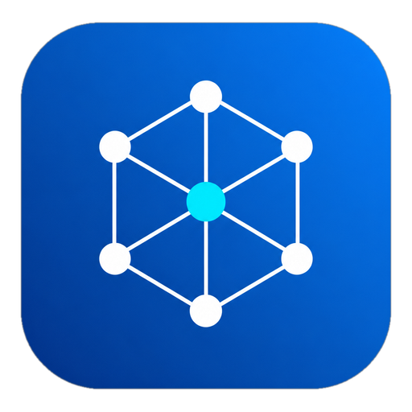
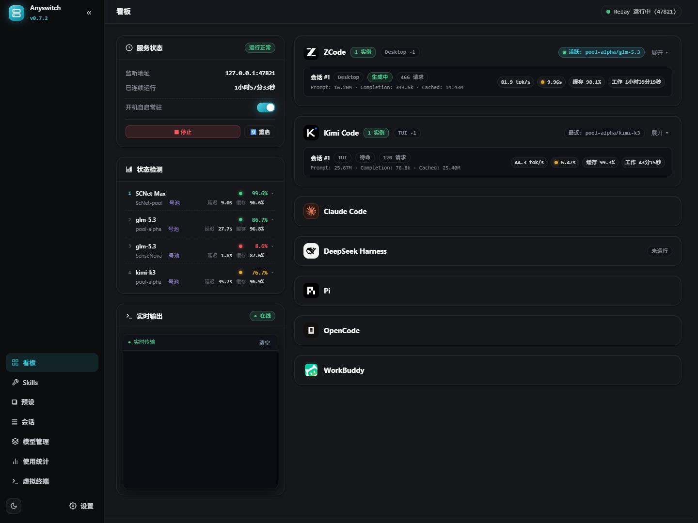
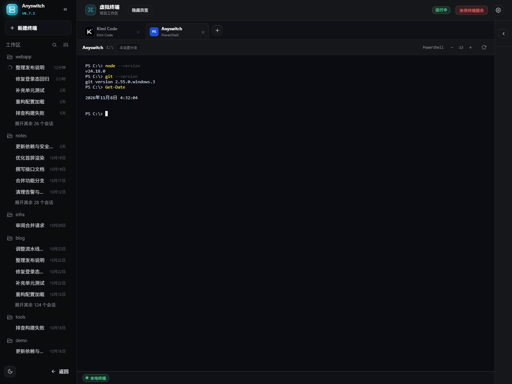
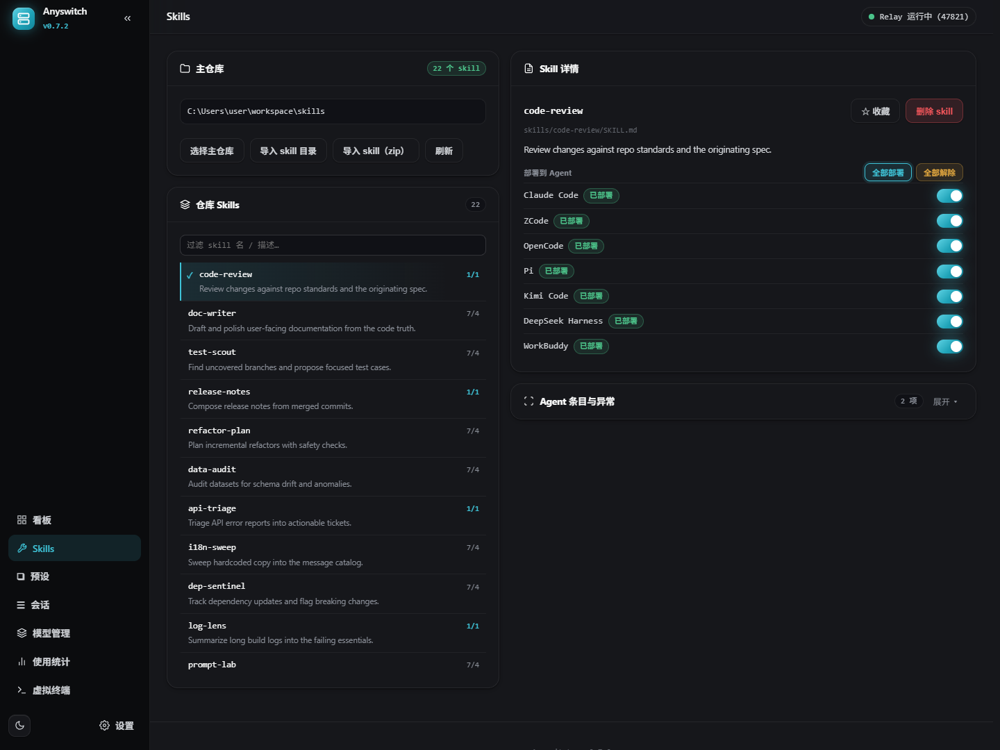

<sub>🌐 <b>中文</b> · <a href="README.en.md">English</a></sub>

<div align="center">

<p></p>

# Anyswitch

**Windows 本地 AI 请求网关与浏览器控制面板**

集中配置模型渠道，将客户端请求转发到你选定的上游，并在浏览器里查看请求、路由和用量。

[下载 Windows x64 安装器](https://github.com/Aurora0134/Anyswitch/releases/download/v0.7.5/anyswitch-v0.7.5-win-x64-setup.exe) · [v0.7.5 源码](https://github.com/Aurora0134/Anyswitch/tree/v0.7.5) · [发布说明](https://github.com/Aurora0134/Anyswitch/releases/tag/v0.7.5)

Windows 10/11 x64。安装器未做代码签名，Windows 可能提示发布者未知。

</div>

## 发出第一条请求

安装后，从开始菜单打开 **Anyswitch (Installed)**。快捷方式会启动本地面板，并在默认浏览器中打开。安装器自带 Node.js。

[打开本地面板](http://127.0.0.1:47820/panel)

1. 在 **模型管理** 中选择 **新增渠道**，填写渠道 ID、上游 Base URL 和 API Key。密钥由 Windows DPAPI 为当前用户加密保存。
2. 保存渠道并等待模型发现。如果上游不提供模型列表，手动添加模型 ID。
3. 如果中继尚未运行，在 **看板 → 服务状态** 选择 **启动**。
4. 在 **虚拟终端** 中打开 **+**，选择已安装的 CLI 客户端并启动。也可以在普通终端通过下方的客户端启动器接入。
5. 在客户端选择已配置的模型，发送一条消息。回到 **看板** 查看请求和结果，或到 **使用统计** 的请求日志查看明细。



截图为早期版本的界面示例。

## 按场景使用

### 接入客户端

Anyswitch 为下列客户端提供启动器。已接入的命令行客户端可以在新开的普通终端里用原命令启动。托管配置把请求指向本地网关，上游 API Key 保存在 Anyswitch。

| 协议 | 客户端启动器 |
| --- | --- |
| Anthropic Messages | [Claude Code](src/launchers/launcher.mjs)、[Kimi Code](src/launchers/kimi-launcher.mjs) |
| OpenAI Responses | [Codex CLI](src/launchers/codex-launcher.mjs) |
| OpenAI 兼容 | [OpenCode](src/launchers/opencode-launcher.mjs)、[Pi](src/launchers/pi-launcher.mjs)、[ZCode](src/launchers/zcode-launcher.mjs)、[ZCode CLI](src/launchers/zcode-cli-launcher.mjs)、[DeepSeek Harness](src/launchers/dsh-launcher.mjs)、[Qoder](src/launchers/qoder-launcher.mjs)、[Grok Build](src/launchers/grok-launcher.mjs)、[WorkBuddy](src/launchers/workbuddy-launcher.mjs) |

源码版也可以显式运行启动器，例如在仓库目录执行 `node src/launchers/codex-launcher.mjs`。ZCode CLI 需要自行准备 CLI 发行物，并将 `ZCODE_CLI_EXECUTABLE` 指向其入口 `bin\zcode.mjs`。

### 设置路由和备用

同一渠道有多个入口时，可配置备用 URL。要在不同渠道间切换，可把渠道组成号池，或为客户端的 `auto` 模型和自定义的虚拟模型设置路由链。看板显示当前路由和各节点状态。

### 查看用量和会话

在使用统计中查看请求数、Token、成功率、首字响应时间和历史趋势。需要查看本机客户端保存的对话时，可打开会话页。

### 在面板里运行 CLI

虚拟终端可打开 PowerShell 或启动检测到的 CLI 客户端，旁边可查看该客户端实例的请求和响应速度。源码版需要先安装终端依赖。 [源码运行步骤](#源码运行)



### 共享提示词预设和技能

启用提示词预设，将常用指令同步到支持的客户端。Skills 页面可从一个本地目录管理技能，再将技能部署到已安装的客户端。



## 源码运行

在 Windows 上安装 Git 和受支持的 Node.js（`>=22.15.0 <23 || >=23.8.0`），然后在命令提示符中执行下列命令。`npm install` 用于虚拟终端，可按需执行。

```bat
git clone --branch v0.7.5 --single-branch https://github.com/Aurora0134/Anyswitch.git
cd Anyswitch
npm install
wscript panel-app.vbs
```

## 升级到 v0.7.5

升级前可备份 `%LOCALAPPDATA%\Anyswitch\`。程序与用户数据分开存放，同一 Windows 用户升级后可继续使用原渠道、凭据、设置、预设和用量记录。请在会话空档升级。重启中继会中断在途请求和运行中的虚拟终端。

### 从旧源码版升级

GitHub 上的 v0.7.4 没有安装器。你可以改用 v0.7.5 的 Windows x64 安装器，保留旧源码目录和用户数据。继续使用源码时，在原仓库目录运行 `git status --short` 并处理本地改动。工作树干净后执行以下命令，再从看板重启服务。

```bat
git fetch --no-tags origin tag v0.7.5
git switch --detach v0.7.5
npm install
```

### 从打包版升级

1. 如果正在使用 **0.7.5-preview**，等请求和终端会话结束后，在看板的 **服务状态** 中选择 **停止**，再选择 **确认停止**。
2. 下载本页顶部的 v0.7.5 安装器，在原安装位置运行。安装器会保留用户数据。
3. 注销并重新登录 Windows，让旧面板进程退出。然后从开始菜单打开 **Anyswitch (Installed)**，在 **设置 → 高级选项 → 更新通道** 选择 **稳定版**。

从 v0.7.5 起，打包版可在 **设置 → 关于** 检查、下载并应用后续更新。面板会验证独立更新包的签名。

## 项目资料

- [架构与运行机制](docs/architecture.md) · [安全模型与漏洞报告](SECURITY.md)
- [用量统计规格](docs/stats-spec.md) · [运行日志规格](docs/runtime-log-spec.md)
- [贡献指南](CONTRIBUTING.md) · [问题反馈](https://github.com/Aurora0134/Anyswitch/issues)
- [Apache-2.0](LICENSE) · [第三方声明](NOTICE)
